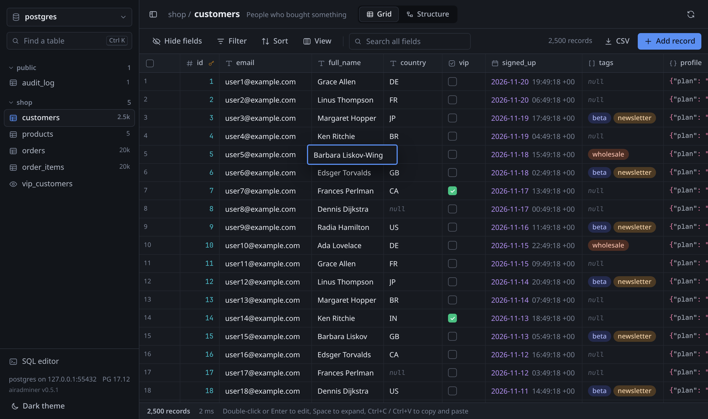

#  airadminer

A spreadsheet interface for PostgreSQL that ships as a single binary.

Deploy it like Adminer: copy one file, run it, open the browser. Use it like Airtable: scroll through millions of rows, edit cells in place, and paste blocks straight from a spreadsheet.

[](https://github.com/13/airadminer/actions/workflows/ci.yml) [](https://github.com/13/airadminer/releases/latest) [](https://github.com/users/13/packages/container/package/airadminer)



## Highlights

- **Fast on large tables.** Virtual scrolling loads rows in pages, so a 50-million-row table opens as fast as a 50-row one.
- **Spreadsheet editing.** Edit in place, use the keyboard like a spreadsheet, and copy and paste TSV with Sheets, Excel and Airtable.
- **Type-aware.** Cells and the record form render booleans, enums, arrays, JSON, timestamps and foreign keys by type.
- **Linked records.** Follow foreign keys in both directions, with suggestions when editing a reference.
- **Shareable views.** Filters, sorts, search and hidden fields live in the URL.
- **Safe writes.** Edits never silently overwrite someone else's change, and each paste or clear saves in one transaction.
- **SQL editor and CSV export.** `-no-sql` turns off the editor and raw SQL filters.
- **TimescaleDB support**, including hypertables and their chunks.
- **One static binary.** No runtime, no config file, no external assets.

## Quick start

Download the linux/amd64 binary:

```sh
curl -LO https://github.com/13/airadminer/releases/latest/download/airadminer-linux-amd64
chmod +x airadminer-linux-amd64
./airadminer-linux-amd64          # then open http://127.0.0.1:8080
```

Or run the container:

```sh
docker run --rm -p 8080:8080 ghcr.io/13/airadminer:latest
```

Or build from source with Go 1.25 or newer:

```sh
make build && ./airadminer
```

## Usage

```sh
./airadminer                                            # login screen
DATABASE_URL=postgres://app@db/app ./airadminer -auth admin:s3cret -addr 0.0.0.0:8080
DATABASE_URL=postgres://app@db/app ./airadminer -readonly
```

Without `-dsn` (or `DATABASE_URL`), people sign in with their own PostgreSQL credentials. With it, everyone uses that one connection. Every flag also has an environment variable; see [Configuration](docs/configuration.md).

## Security

- By default the server listens on loopback only.
- **`-dsn` without `-auth` on a non-loopback address gives your database to anyone who can reach the port.**
- `-readonly` is a safety rail, not a security boundary. For real read-only access, connect as a limited PostgreSQL role and add `-no-sql`.

See [Security notes](docs/security.md) for the full list.

## Documentation

- [Features](docs/features.md): the grid, records, structure, SQL editor and shortcuts
- [Install and configuration](docs/configuration.md): Docker, every flag and environment variable
- [Security notes](docs/security.md): network exposure, sessions, login restrictions
- [Operations](docs/operations.md): logs, audit log, metrics, HTTPS, single sign-on
- [How editing works](docs/internals.md): row keys, conflict checks, TimescaleDB, reconnects
- [Build and development](docs/development.md): make targets, tests and project layout

## Development

```sh
make demo     # throwaway PostgreSQL on :55432 with sample data
make test     # go vet, go test -race, JS syntax check
make e2e      # browser tests in headless Chrome (needs make demo)
```
